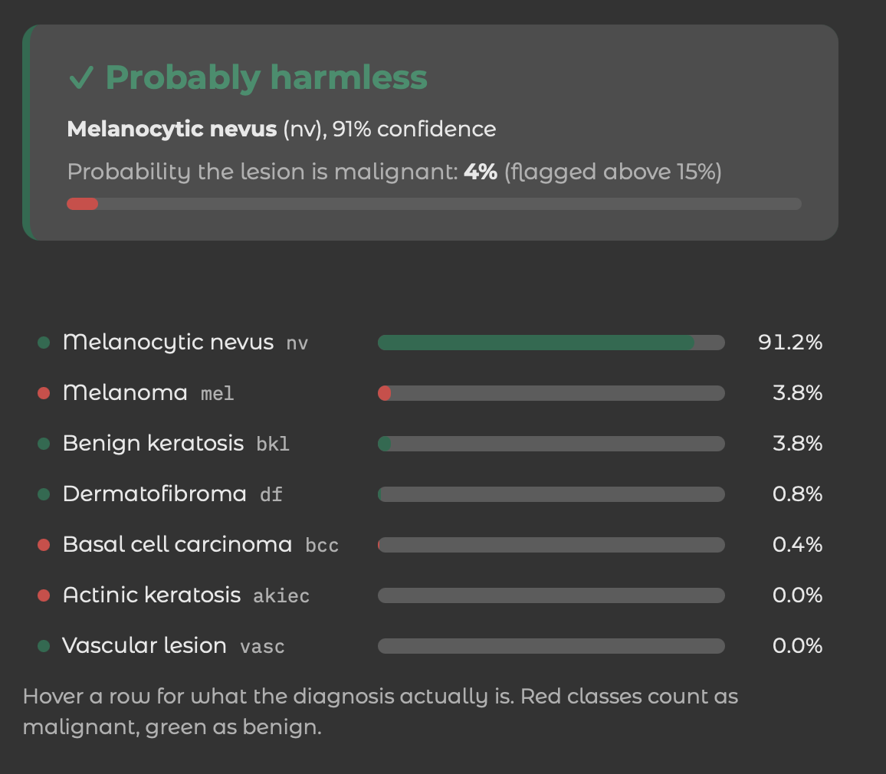

# melanoma-classifier

[](https://github.com/miloszkrawczyk/melanoma-classifier/actions/workflows/tests.yml)
[](https://huggingface.co/miloszkrawczyk/skin-lesion-classifier)
[](https://creativecommons.org/licenses/by-nc/4.0/)

### [→ Try it live](https://skin-lesion-classifier.blackmoss-34728f66.germanywestcentral.azurecontainerapps.io)

Hosted on Azure Container Apps, scaled to zero. The first request after a
quiet spell takes about a minute while the container wakes up and loads the
weights; after that it answers in well under a second.

A skin lesion classifier trained on HAM10000, wrapped in an API, containerised
and given a web interface. Upload a photo, get one of seven diagnoses, a
malignant/benign call, and a heatmap of what the model actually looked at.

**This is an educational project, not a diagnostic tool and not a medical
device.** It is wrong often enough to matter. Anything on your skin that is
new, changing or worrying you is a question for a dermatologist.



---

## Why this exists

The point was not the model. Training a classifier is a week's work and
`mnist-classifier` already covered that ground. The point was everything that
sits around it: getting the split right so the score means something, choosing
a decision rule that matches what the mistakes actually cost, and taking the
thing all the way from a `.pth` file on my laptop to a service someone else
can call.

Three things came out of it that I did not expect going in, and they are the
parts worth reading:

1. **The split has to be by lesion, not by photo.** HAM10000 photographs some
   lesions more than once. A random split puts the same lesion on both sides,
   the model recognises pictures it has effectively seen, and the test score
   comes out flattering and useless.
2. **Taking the top class is the wrong rule here.** It treats a false alarm and
   a missed cancer as equally bad, and they are not remotely equal. Adding up
   the malignant probabilities and comparing against a threshold takes recall
   from 76.8% to 92.0% on the same weights, with no retraining.
3. **A classifier is confident about rubbish.** Shown random noise, it returned
   "benign keratosis" at 86.5% certainty. Nothing in the training makes it
   capable of saying "that is not a skin lesion", so that check has to be built
   separately.

## What it does

Every prediction answers three questions independently, because they fail
independently:

| question | how it is answered |
|---|---|
| Is this even a skin photo? | a heuristic on texture, saturation and red dominance |
| Which diagnosis is it? | the top of seven classes, but only if above 60% confidence |
| Should it be treated as malignant? | the three malignant probabilities summed, against a 0.15 threshold |

The last one stands even when the second gives up. The model can be sure a
lesion is malignant while having no idea which of the three malignant
diagnoses it is looking at, and that is still a useful answer.

```json
{
  "diagnosis": "mel",
  "name": "Melanoma (mel)",
  "confidence": 0.898,
  "confident": true,
  "looks_like_skin": true,
  "malignant_probability": 0.921,
  "category": "malignant",
  "probabilities": { "akiec": 0.022, "bcc": 0.001, "...": "..." }
}
```

## Results

Held-out test set, 1508 images, 314 of them malignant. Run once, on the
finished model, after every decision had already been made against the
validation set.

**The malignant call, which is the number this project exists to move:**

| | top-class rule | threshold at 0.15 |
|---|---|---|
| recall on malignant | 76.8% | **92.0%** |
| precision on malignant | 55.8% | 43.0% |
| malignant lesions missed | 73 of 314 | **25 of 314** |
| false alarms | 191 of 1194 | 383 of 1194 |

Same weights, same photos, different reading of the same seven numbers. For a
screening tool the right-hand column is the right trade: a false alarm costs an
appointment, a miss costs considerably more.

**These figures predate one change the service has since made.** It now shows
the network each photo four times, turned by a quarter each time, and averages
the four answers. On validation that takes recall from 93.9% to 95.2%, four
missed lesions out of eighteen, and raises PR-AUC from 0.721 to 0.742, which
says the ranking improved rather than the operating point sliding. It costs 36
more false alarms. The table above was measured before it, on the test set,
which has been used once and is staying that way until there is a retrained
model worth spending it on. See `results/07-tta.txt`.

**Per class, taking the top class:**

| class | | support | recall | precision |
|---|---|---|---|---|
| `akiec` | actinic keratosis | 60 | 53.3% | 46.4% |
| `bcc` | basal cell carcinoma | 79 | 72.2% | 63.3% |
| `bkl` | benign keratosis | 195 | 45.6% | 74.2% |
| `df` | dermatofibroma | 12 | 75.0% | 24.3% |
| `mel` | melanoma | 175 | 66.3% | 42.5% |
| `nv` | melanocytic nevus | 967 | 83.4% | 91.1% |
| `vasc` | vascular lesion | 20 | 100.0% | 58.8% |

Two of those rows rest on fewer than 25 photographs each, `df` and `vasc`, and
a single photograph moves their recall by several points. Read them with the
caveat under Limitations rather than as measurements.

Accuracy is 74.9%. That number is close to meaningless here and I am including
it mainly to say so: nearly two thirds of the test set are ordinary moles, so a
model answering `nv` to everything scores 64.1% while knowing nothing.

### How it got there

Four training runs, each changing one thing, each recorded in `results/`:

| | accuracy | recall on malignant | false alarms | val loss |
|---|---|---|---|---|
| 01 · CNN from scratch | 59.4% | 60.8% | 250 | 1.0367 |
| 02 · plus augmentation | 57.7% | 89.8% | 446 | 1.0817 |
| 03 · plus 40 epochs | 62.2% | 77.8% | 282 | 0.9478 |
| 04 · ResNet18, fine-tuned | 78.2% | 77.5% | 159 | 0.6373 |

Run 02 is the interesting one. Accuracy and validation loss both got *worse*,
and it was clearly the better model: missed cancers fell from 115 to 30.
Watching only the headline number would have made me revert it.

The from-scratch CNN is still in the repo, at `src/models/cnn.py`. It exists to
be compared against, not to be used.

## Decisions worth defending

**Split by `lesion_id`, seeded.** 10,015 photos of 7,470 lesions. Splitting on
rows would leak 2,545 duplicate photographs across the boundary. `tests/`
enforces this: the assertion that no lesion appears in two sets is the single
most valuable test in the project, because the failure it catches is invisible
at runtime.

**Class weights, inversely proportional to frequency.** `nv` is 67% of the
data, `df` is 1%. Without weighting, answering "ordinary mole" to everything is
a local optimum the network is happy to sit in.

**Normalisation statistics measured, not inherited.** Skin close-ups average
`(0.764, 0.546, 0.571)` against ImageNet's `(0.485, 0.456, 0.406)`, and vary
about half as much. `scripts/compute_stats.py` measures them, over the training
split only, since even a mean leaking from the test set is a leak.

**Threshold chosen from a sweep, not from taste.** `scripts/tune_threshold.py`
prints recall and precision at every threshold from 0.05 to 0.95. 0.15 was
picked from that table on validation, and held up on test: 93.9% promised,
92.0% delivered.

**Grad-CAM as a check, not a decoration.** HAM10000 contains photos with rulers
and ink marks in frame. A model that learned to key on those would score well
and be worthless. The attention maps show the heat landing on the lesion, which
is the only reason to believe the rest of this.

## Running it

```bash
uv sync
```

The dataset and the weights are both gitignored, being 2.9 GB and 43 MB of
binary that any clone can rebuild or fetch. Two ways to get a working model:

```bash
# fetch the trained weights (43 MB)
uv run hf download miloszkrawczyk/skin-lesion-classifier resnet.pth --local-dir weights/

# or train them yourself, about 25 minutes on an M-series Mac
uv run python -m scripts.download_data     # needs a Kaggle API token
uv run python -m src.train resnet
```

Then either run it directly:

```bash
uv run uvicorn api.main:app --port 8000     # http://127.0.0.1:8000
```

or in a container, which is how it is meant to be deployed:

```bash
docker build -t skin-lesion-classifier .
docker run -p 7860:7860 skin-lesion-classifier
```

`deploy/azure.md` has the commands behind the live demo, including the two
things that went wrong getting there.

| path | |
|---|---|
| `/` | the web interface |
| `/predict` | POST an image, get JSON |
| `/explain` | POST an image, get the attention map as a PNG |
| `/docs` | interactive API documentation, generated by FastAPI |

### Everything else

```bash
uv run python -m src.evaluate resnet          # metrics on validation
uv run python -m scripts.tune_threshold resnet # the recall/precision trade-off
uv run pytest                                  # 23 tests
uv run ruff check .
```

## Project structure

```
src/
├── config.py          every constant, with the reasoning next to it
├── data.py            metadata, the lesion-level split, Dataset, DataLoader
├── device.py          mps / cuda / cpu
├── train.py           one loop, both models, chosen by argument
├── evaluate.py        confusion matrix, per-class recall and precision
├── predict.py         one photo in, an answer out. The API's only entry point
├── gradcam.py         attention maps
└── models/
    ├── cnn.py         the from-scratch baseline
    └── resnet.py      pretrained ResNet18 with a seven-class head
api/main.py            FastAPI, and the Gradio app mounted alongside it
frontend/ui.py         the interface
scripts/               data download, exploration, statistics, plots, deploys
tests/                 23 tests, 9 of which skip without the dataset
results/               every training run, with its full configuration
```

`src/predict.py` imports neither `train.py` nor `data.py`, so the web service
carries no training code and no pandas. That separation is enforced by what
the container actually installs.

## Limitations

Written out rather than buried, because knowing where a model fails is the
useful part.

**It was trained on the wrong kind of photograph.** HAM10000 is dermatoscope
imagery: a lens pressed against the skin under even light. The interface
invites phone snapshots, which look different enough that accuracy on them is
unknown and near-certainly worse. This is the largest limitation and it cannot
be fixed with better code, only with different data.

**Two classes carry numbers that mean very little.** `df` has 12 test images
and `vasc` 20, and "very little" is measurable rather than a feeling. With 12
images, 75% recall means nine of twelve, and the 95% interval around it runs
from 46.8% to 91.1%: 44 points wide, spanning "barely better than a coin" to
"excellent". `vasc` looks perfect at 100%, which is 20 of 20 and consistent
with a true rate as low as 83.9%. For contrast, `nv` rests on 967 images and
moves 4.7 points. The intervals for every class are in
`results/05-test-set.txt`.

**Melanoma recall is 66.3% under the top-class rule**, and 37 melanomas were
called ordinary moles. The threshold rule catches most of those, which is the
whole argument for using it, but the seven-way answer is genuinely weak on the
class that matters most.

**The "is this skin" check is a heuristic, not a classifier.** It measures
local roughness, colour saturation and red dominance. It turns away noise, flat
colours, greyscale images and diagrams, and it wrongly rejects 6 of 1521
validation photos. It will happily accept a photograph of a textured beige
wall. A real fix needs a second model trained on skin/not-skin pairs.

**The published weights are still a pickle.** `.pth` files execute whatever
they contain when loaded, and the instruction above tells you to download one
off the internet, so "mine is safe because I made it" was never the point.
Loading now refuses anything that is not a tensor, training writes
`safetensors`, and that is the format the container ships. What is still on the
Hub is the original `.pth`, until I push the converted file.

## What I would do next

**Retrain on PAD-UFES-20.** 2,298 smartphone photographs, CC BY, with patient
metadata included. It matches how the application is actually used, and would
address the limitation above rather than working around it.

**Use the metadata.** Age, sex and lesion site are sitting unused in the CSV.
Melanoma distributes differently on a back than on a palm.

**Test-time augmentation.** Average the prediction over a few rotations of the
same photo. Usually worth a point or two for a few lines of code.

## Credit

Data: Tschandl P., Rosendahl C., Kittler H. *The HAM10000 dataset, a large
collection of multi-source dermatoscopic images of common pigmented skin
lesions.* Scientific Data 5, 180161 (2018).
[doi:10.1038/sdata.2018.161](https://doi.org/10.1038/sdata.2018.161)

Licensed CC BY-NC 4.0, which the trained weights inherit. Non-commercial use
only.

Built by [Miłosz Krawczyk](https://github.com/miloszkrawczyk) as a portfolio
project, following on from
[mnist-classifier](https://github.com/miloszkrawczyk/mnist-classifier) and
[neural-net-from-zero](https://github.com/miloszkrawczyk/neural-net-from-zero).
